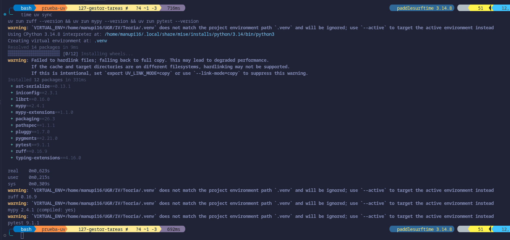
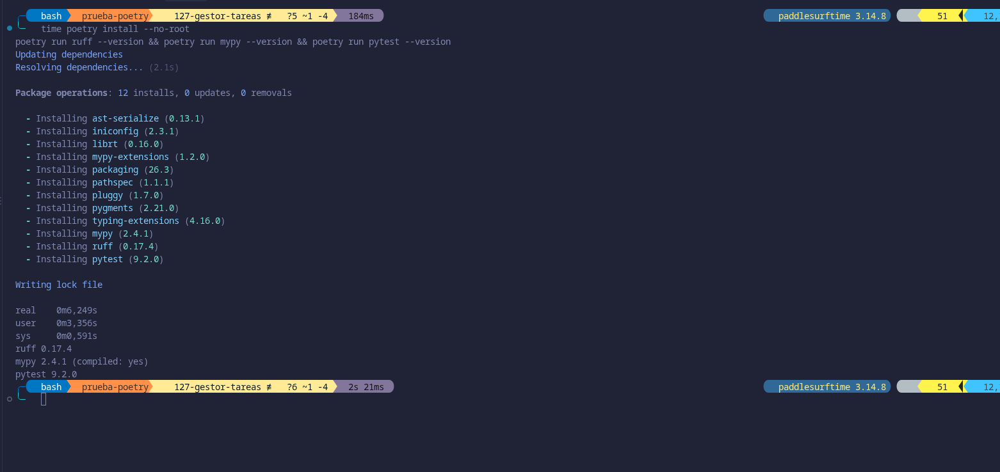
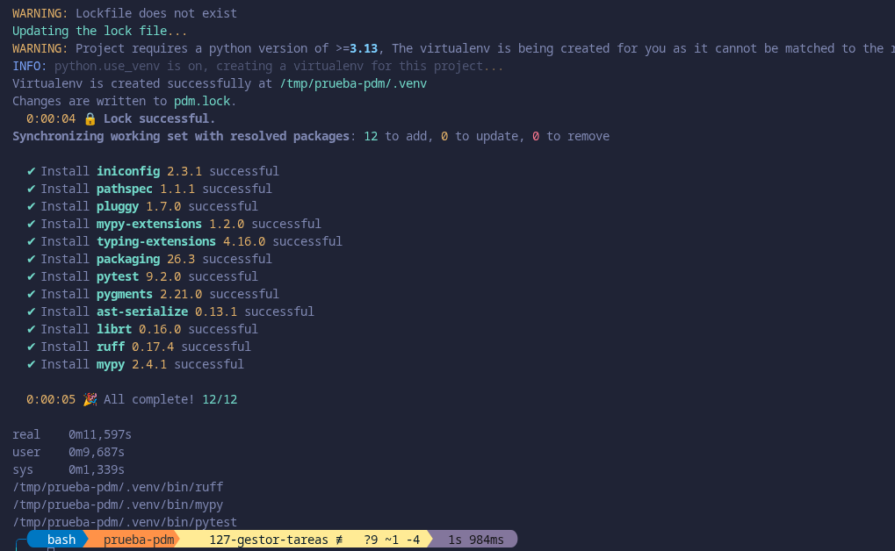
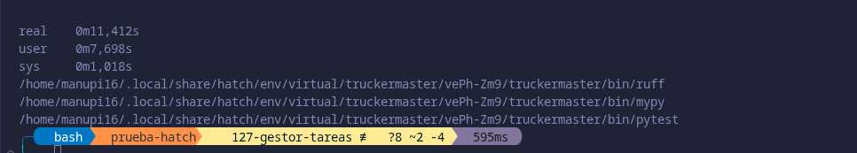
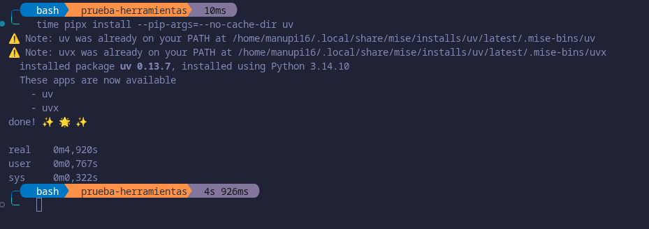
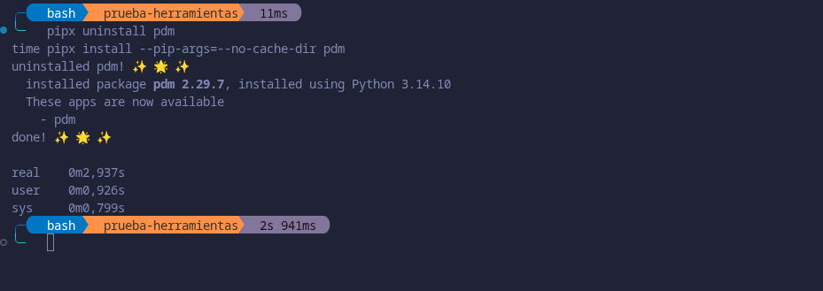
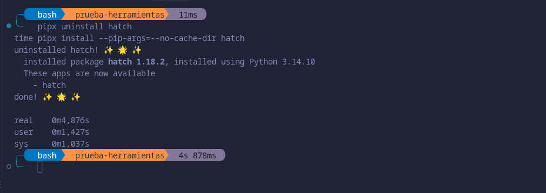
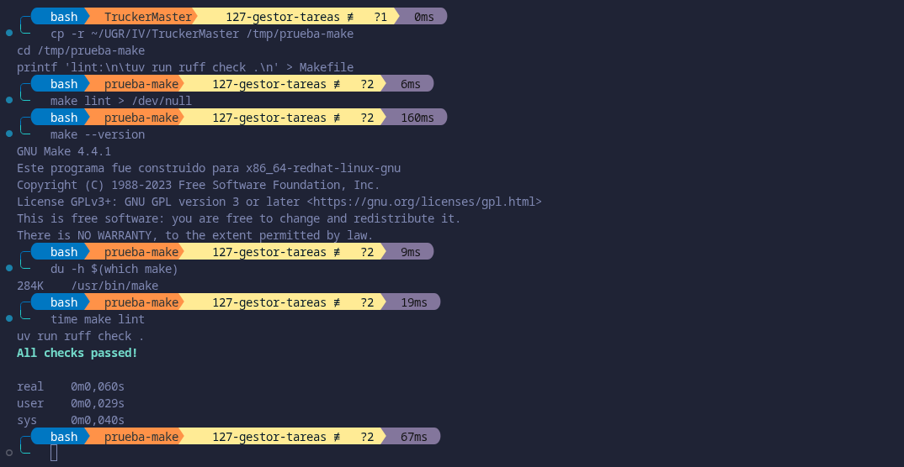
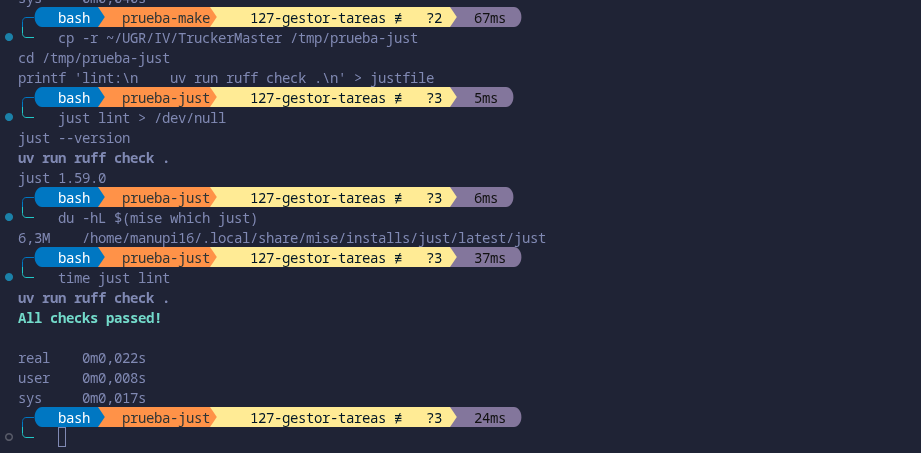
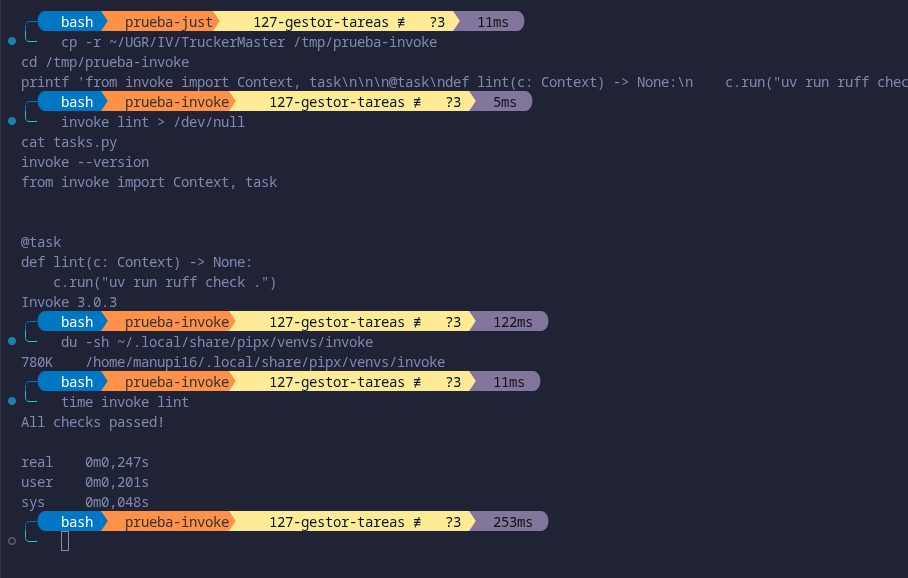

# Elección de Herramientas

## Gestor de dependencias

Antes de nada destacar que un PEP se trata de un documento de diseño que informa a la comunidad de Python o describe una nueva característica del lenguaje, de sus procesos o de su entorno. El fichero estándar para declarar las dependencias es `pyproject.toml`, ya que lo definen varios PEP, `PEP 518` crea el fichero para las dependencias necesarias para construir el proyecto. El `PEP 621` define en él la tabla `[project]`, donde van las dependencias del proyecto, y el `PEP 735` se encarga de definir `[dependency-groups]` para las dependencias que no forman parte del paquete que se distribuye. En otras asignaturas, se suele usar `requirements.txt`, pero el propio `PEP 735` indica que no está estandarizado ya que son opciones para `pip` y la documentación de `pip` dice que su formato solo está pensado para que lo lea pip. Luego solo se tienen en cuenta los gestores que trabajan con `pyproject.toml`.

Todos los gestores que se comparan tienen que poder hacer despliegues idempotentes, es decir, que al instalar el proyecto en cualquier máquina, y las veces que sea, quede siempre el mismo entorno con las mismas versiones de las dependencias. Esto es necesario porque el proyecto se va a instalar en workflows vacíos, y si cada instalación sacara versiones distintas, los tests podrían pasar en una y fallar en otra sin haber cambiado el código. Los cuatro gestores candidatos lo cumplen guardando la versión exacta de cada dependencia (uv en `uv.lock`, Poetry en `poetry.lock`, PDM en `pdm.lock` y Hatch en `pylock.toml`, este último solo si se activa `locked = true` en el entorno) e instalando a partir de ella, así que no sirve para elegir entre ellos. Para elegir se usan estos criterios:

- **¿Hay que instalar algo?:** si hace falta instalar algo antes de poder usarlo. En un entorno vacío, cada cosa que haya que instalar antes es tiempo que se suma y un paso más que puede fallar.
- **Tiempo de instalación de la herramienta:** lo que tarda en descargarse e instalarse el propio gestor.
- **Tiempo de instalación del proyecto:** lo que tarda en instalar el proyecto con sus dependencias.

Destacar que debajo de la tabla se incluyen unas capturas, para contrastar los datos, sobre las diversas mediciones realizadas sobre los gestores.

| Herramienta | Hay que instalar algo | Tiempo de instalación de la herramienta | Tiempo de instalación del proyecto |
|---|---|---|---|
| uv | No, es un único programa | 4,920 s | 0,623 s |
| Poetry | Sí, Python | 3,712 s | 6,249 s |
| PDM | Sí, Python | 2,937 s | 11,597 s |
| Hatch | Sí, Python | 4,876 s | 11,412 s |

Medida de uv:

Medida de Poetry:

Medida de pdm:

Medida de hatch:

Tiempo de instalación de uv:

Tiempo de instalación de Poetry:

Tiempo de instalación de PDM:

Tiempo de instalación de Hatch:

Se miden los dos tiempos porque, según indica el guion, lo que se elija ahora se va a usar en entornos donde la velocidad de instalación es esencial. En un workflow sin caché cada ejecución empieza en un entorno vacío, así que hay que instalar primero el gestor y después el proyecto, y los dos tiempos se tienen en cuenta. El proyecto tiene `ruff`, `mypy` y `pytest` en el grupo `dev`, y se comprobó en cada medición que los cuatro gestores los instalaban. Hatch no lo hace por sí solo: la medición de Hatch se hizo añadiendo `dependency-groups = ["dev"]` a su entorno en `pyproject.toml`, y sin esa línea el entorno se crea (3,069 s) pero sin `ruff`.

Sumando los dos tiempos, uv tarda 5,543 s, Poetry 9,961 s, PDM 14,534 s y Hatch 16,288 s. Hatch es el que más tarda y además necesita configuración extra para instalar las dependencias de desarrollo, así que se descarta. PDM es el que antes se instala, pero instala el proyecto en 11,597 s, y Poetry tarda 6,249 s. uv no es el más rápido en instalarse (4,920 s), pero instala el proyecto en 0,623 s, y además es un único programa que no necesita Python para instalarse. Por eso se elige uv.

## Gestor de tareas
 
Un gestor de tareas permite lanzar, como subcomandos de un solo programa, todas las tareas que hay que llevar a cabo en el proyecto definidas en un único fichero. Ahora mismo, para comprobar el código hay que ejecutar a mano `uv run ruff check .`, `uv run mypy` y `uv run pytest`, y el workflow `lint.yml` repite esas órdenes por su cuenta.

Se comparan make, invoke y just. Destacar que uv no permite definir tareas, luego no sirve como gestor de tareas. Los criterios a saber son los siguientes:

- **Estilo de configuración:** declarativa (las tareas se describen en un fichero) o imperativa (se escriben como código).
- **Estándar:** si la herramienta sigue un estándar.
- **Qué hay que instalar:** qué hace falta para usarla.
- **Espacio que ocupa:** lo que ocupa la herramienta una vez instalada.
- **Tiempo en ejecutar `lint`:** lo que tarda en lanzar una tarea `lint` que ejecuta `uv run ruff check .`.

Se adjuntan capturas mostrando las mediciones, para contrastar los datos.

| Herramienta | Estilo de configuración | Estándar | Qué hay que instalar | Espacio que ocupa | Tiempo en ejecutar `lint` |
|---|---|---|---|---|---|
| make | Declarativa | Sí (POSIX) | Nada | 284 KB | 0,060 s |
| just | Declarativa | No | Un único programa | 6,3 MB | 0,022 s |
| invoke | Imperativa | No | Un paquete de Python | 780 KB | 0,247 s |

Mediciones de Make:

Mediciones de Just:

Mediciones de Invoke:

Se tiene observando la tabla que invoke es el único imperativo, definiendo las tareas en un archivo `.py`. Además se trata de un paquete que hay que instalar y es el que más tarda en ejecutar `lint`. Por otro lado, just es el más rápido, pero la diferencia con make es de unas centésimas de segundo, mientras que make sigue un estándar (POSIX), no hay que instalar nada y ocupa 284 KB frente a los 6,3 MB de just.

Por tanto, se elige make, donde cada objetivo del `Makefile` es una tarea que se lanza con `make <tarea>`.
